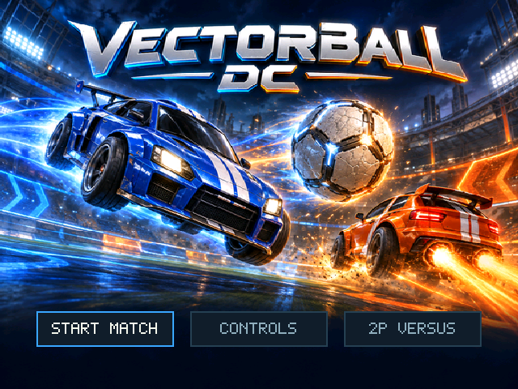

# Vectorball DC

A car-soccer game for the Sega Dreamcast, built with KallistiOS / DreamSDK.



## Build

In a configured DreamSDK terminal:

```sh
make clean
make gdemu
```

Then load `gdemu/01/disc.cdi`.

## Tests

Host-side physics and gameplay checks: `sh tests/run.sh`

See [README_FIRST.md](README_FIRST.md) for the current version notes and controls, and [HANDOFF.md](HANDOFF.md) for implementation history.
